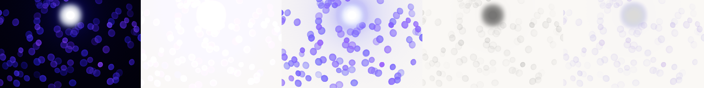
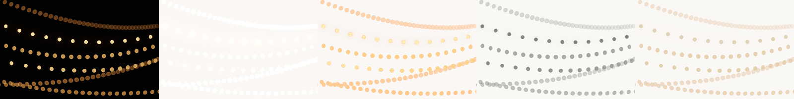
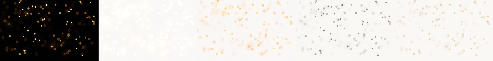
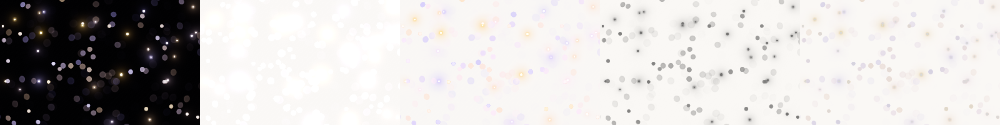
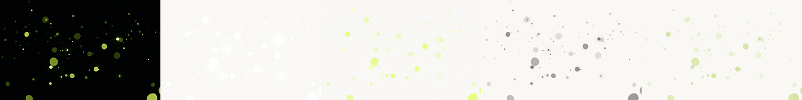
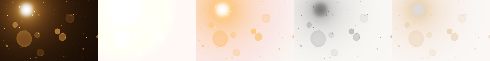
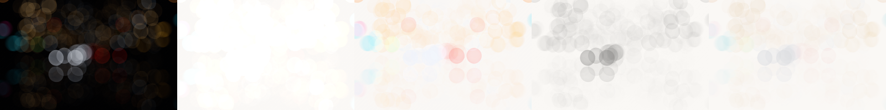
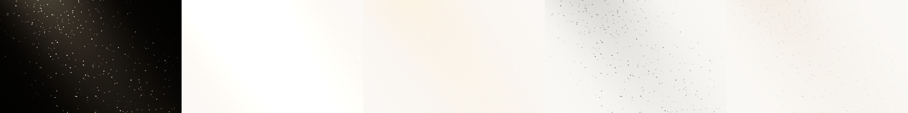
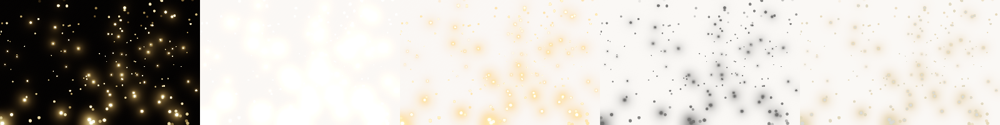
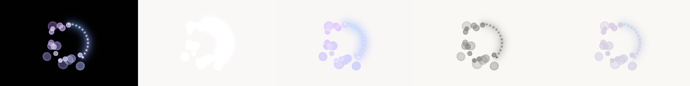

# Bokeh on a light page

Story 7.5. Each bokeh effect rendered once at its defaults (320 × 200, two seconds in, on Dawn), its light laid over a light page (`#faf8f5`) four ways, numerically. The method and the four strategies are described in `experiments/light-pages.test.ts`; re-run with `npx vitest run --config experiments/vite.config.ts experiments/light-pages.test.ts`. Each cell: how visible the discs are (mean difference from the bare page, 8-bit levels, where the effect has light) / the share of the frame darkened by more than 20%, where text would suffer.

## Decision per effect

- **Additive is never the answer.** A light page has five to ten 8-bit steps of headroom, and every effect here moved it by 5 to 7: invisible, as Fire Temple's 3.3 found for fire.
- **Luminance alpha, the overlay default, is the one that works for warm, sparse lights.** Each disc hides as much page as it is bright and shows its own colour there: fairy-lights, focus-cursor, fireflies, snow-at-night and bokeh-loader all read clearly (20 to 40 levels) and darken almost none of the page. `fairy-lights` now has it as `page: light` (the preset "over a light page", `lightPage: 'underlay'`); the others are the same change (spread `OVERLAY_PARAMS`, clear to transparent) when they are wanted on a light page.
- **Dense or cool fields stay in a dark section.** bokeh-drift's violet field under luminance alpha reads as ink, not light, and darkens a quarter of the page past what text tolerates. Low-light scenes (night-street, dust-in-light, focus-pull) barely show at all. Their `lightPage` stays `no`: give them a dark band of their own.
- **Shadow bokeh is a different picture, not a fallback.** Grey discs read as shade: dappled light inverted. It is the most visible strategy (20 to 56 levels) and it is the only one that costs real page, so it belongs to an effect whose subject is shade, which none of these is.
- **Tinted glass is the gentle option.** Pastel discs a third as visible as luminance alpha, never darkening the page: for a light page that carries text over the whole effect, as a hero background would.

## The measurements

| Effect | Additive | Luminance alpha | Shadow bokeh | Tinted glass |
| --- | ---: | ---: | ---: | ---: |
| bokeh-drift | 5.9 / 0.0% | 50.5 / 25.3% | 16.4 / 3.2% | 8.7 / 0.0% |
| fairy-lights | 7.3 / 0.0% | 39.4 / 0.0% | 53.1 / 6.3% | 28.7 / 0.0% |
| focus-cursor | 6.8 / 0.0% | 24.4 / 0.0% | 33.9 / 1.6% | 17.8 / 0.0% |
| focus-pull | 7.3 / 0.0% | 8.6 / 0.0% | 33.6 / 3.2% | 11.6 / 0.0% |
| fireflies | 7.2 / 0.0% | 29.9 / 0.0% | 55.8 / 1.9% | 28.4 / 0.0% |
| snow-at-night | 5.0 / 0.0% | 30.3 / 0.0% | 24.5 / 6.3% | 15.5 / 0.0% |
| night-street | 7.1 / 0.0% | 9.4 / 0.0% | 20.5 / 1.9% | 8.5 / 0.0% |
| dust-in-light | 7.3 / 0.0% | 5.4 / 0.0% | 18.8 / 0.6% | 7.2 / 0.0% |
| glitter | 7.1 / 0.0% | 15.4 / 0.0% | 32.3 / 4.2% | 14.5 / 0.0% |
| bokeh-loader | 7.3 / 0.0% | 19.9 / 0.0% | 44.8 / 3.8% | 18.1 / 0.0% |

Each image: the effect on its own night, then additive, luminance alpha, shadow bokeh and tinted glass over the light page.

