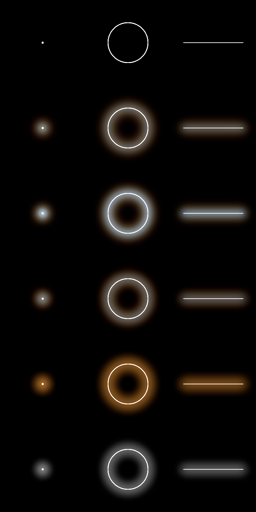
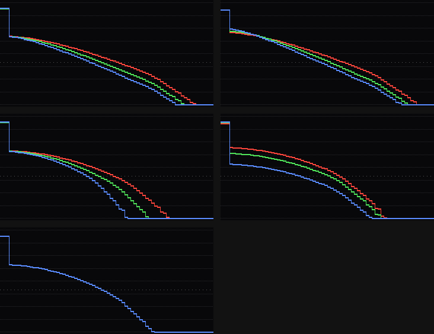

# Spectral bloom against a radius per channel and halation

Story 10.2. `experiments/spectral-bloom.test.ts`, on Dawn (Metal) on this machine (Apple M1 Max), 2026-10-27; it writes `spectral-bloom.json` beside this file and the pictures in `spectral-bloom/`:

    npx vitest run --config experiments/vite.config.ts experiments/spectral-bloom.test.ts

## What was compared

Three white shapes in a 256 × 256 rgba16float scene, each alone: a **point** (a disc 3 px in radius at radiance 40), a **ring** (radius 60 px, a line 2 to 3 px wide at 12) and a **line** (180 px long, 2.5 px wide at 12). Each was passed through five halos, all moving light rather than adding it, at the same settings: 30% of 700 nm light scattered, red sigma 16 px, spread 3 (red's sigma three times violet's), 16 bands.

| Method       | What it is                                                                                                                                                                                                                                                                            |
| ------------ | ------------------------------------------------------------------------------------------------------------------------------------------------------------------------------------------------------------------------------------------------------------------------------------- |
| **spectral** | `createSpectralBloom`, the default: 16 wavelengths, each scattering a share in proportion to its sigma squared (balance 1), fitted to 4 to 6 blurs of a pyramid. Here that scatters 17% of red, 12% of green and 9% of blue, with sigmas (per channel, RMS) of 12.6, 10.9 and 9.7 px. |
| **even**     | The same with balance 0: every wavelength scatters the same share, only the width differs.                                                                                                                                                                                            |
| **channel**  | `mode: 'channel'`: one Gaussian per channel, scattering the share and with the variance the spectral kernel gives that channel. The fair "radius per channel" bloom: it holds as much light and reaches as far on average.                                                            |
| **halation** | 2.5's `createHalation` as it is: red scatters 30%, green 10.5%, blue 1.5%, all at one sigma (the channel bloom's red sigma, 12.6 px).                                                                                                                                                 |
| **plain**    | `mode: 'plain'`: one white Gaussian with the luminance-weighted share and variance.                                                                                                                                                                                                   |

Measured on each: the total of each channel before and after; the mean colour in 1 px bins going outwards (from the point's centre, out from the ring, across the middle of the line); the colour a viewer would name in each bin (hue and saturation of the colour normalised to its brightest channel and sRGB-encoded: white below 0.2 saturation, then red, orange 15 to 38°, yellow 38 to 68°...), as runs of at least 2 px while the halo's luminance is above 0.002 (about 6/255 on a black page); and how far that visible halo reaches. The same is repeated for a source ten times brighter (threshold 0.0002), which sees further down the same tail.

## Energy: white in, white out

Every method keeps every channel's light: the totals after are within 0.07% of before, for every shape and method, and the three channels' totals stay equal, so white integrates to white. On a 960 × 540 scene, whose pyramid levels do not halve evenly (135 rows, then 68), the spectral, channel and plain blooms keep 99.93 to 99.96%.

That last number needed the pyramid's levels to be averaged over each texel's exact footprint. A bilinear tap at the texel's centre, which is an exact 2 × 2 average when the size halves, samples every other row when 135 rows go to 68, and lost 0.95% of the red of a thin ring.

## Colour going outwards

From the white point, by distance in pixels. Hue in degrees / saturation, then R/B of the halo:

| Method   | 4 px     | 8 px     | 16 px   | 24 px   | 32 px   | 40 px   | R/B at 4, 16, 32, 40 px |
| -------- | -------- | -------- | ------- | ------- | ------- | ------- | ----------------------- |
| spectral | 37/0.05  | 36/0.12  | 31/0.31 | 26/0.45 | 23/0.54 | 20/0.62 | 1.1, 2.3, 5.7, 8.3      |
| even     | 214/0.22 | 207/0.15 | 47/0.12 | 32/0.35 | 26/0.48 | 21/0.57 | 0.57, 1.4, 4.3, 6.5     |
| channel  | 37/0.07  | 35/0.11  | 31/0.27 | 27/0.46 | 26/0.69 | 24/0.95 | 1.2, 2.0, 12.9, 235     |
| halation | 30/0.75  | 30/0.75  | 30/0.75 | 30/0.75 | 30/0.75 | 30/0.75 | 20 at every distance    |
| plain    | white    | white    | white   | white   | white   | white   | 1                       |

The named bands, and the reach of the visible halo (px), at the source's brightness and ten times brighter:

| Method   | Point                               | Ring                   | Line                   |
| -------- | ----------------------------------- | ---------------------- | ---------------------- |
| spectral | white, orange; 35 / 46              | white, orange; 31 / 43 | white, orange; 31 / 43 |
| even     | white, blue, white, orange; 37 / 48 | white, orange; 34 / 44 | white, orange; 34 / 45 |
| channel  | white, orange; 34 / 41              | white, orange; 30 / 38 | white, orange; 30 / 39 |
| halation | white, orange; 37 / 43              | white, orange; 33 / 40 | orange; 33 / 39        |
| plain    | white; 34 / 41                      | white; 30 / 37         | white; 30 / 37         |

## Findings

1. **All five conserve light per channel to better than 0.1%**, the spectral bloom included, so its colour is moved, never made: the red rim is red light taken from the line, and the blue it leaves behind stays in the line.
2. **For an RGB scene the spectral bloom is a bloom with one kernel per channel**, each a mixture of Gaussians. Matched in share and variance, the per-channel bloom with three single Gaussians looks almost the same: within a couple of degrees of hue out to 24 px (1.5 red sigma), and the same named bands. The difference is in the tail. The per-channel Gaussians' R/B shoots up past two sigma (12.9 at 32 px, 235 at 40), so the halo ends in a thin saturated rim just where it fades out; the spectral mixture's R/B climbs steadily (5.7, 8.3), its hue turns smoothly from 37° to 20° across the whole halo, and for a bright source its visible halo reaches 12% further (46 px against 41 for the point).
3. **No method draws four separate bands.** By the names above, the spectral and per-channel halos are white, then orange: in between the hue passes through a pale gold (36 to 38°) too unsaturated to count as yellow, and the outermost visible halo stops at red-orange (about 20°), never 0°. The limit is the colour fit: Zucconi's `spectralRgb` gives the longest wavelengths some green and blue a bump at 560 to 640 nm, so no mixture of its bands is a pure red. Under the tail's tonemap the dim outer halo reads amber-brown.
4. **Equal shares make a blue ring.** With balance 0 (even), the narrow blue halo is the densest next to the light, so the halo runs white, pale blue (214°), white, then orange: the arithmetic of conserving each channel while only the width changes. Scattering in proportion to sigma squared (balance 1, the default) gives every band's halo the same starting brightness, and the halo starts white instead.
5. **Halation has one colour.** 2.5's halation scatters each channel by a different amount but over one width, so its halo is the same orange (30°, saturation 0.75) at every distance: a film's look, but not a halo that changes colour outwards.
6. **Cost.** Wall-clock on Dawn at 1920 × 1080, best of five runs of 100 frames of the pass alone, two runs of the experiment: spectral 1.3 to 1.5 ms (5 anchors at the gallery's defaults, pyramid levels 2 to 4), per-channel about 1.0 ms (3 anchors), halation 0.9 to 1.0 ms, plain 0.6 ms (1 anchor), an empty pass 0.1 ms. These are rough (the machine was shared and `even`, identical work to `spectral`, measured 1.1 and 1.5); `npm run study` has not been run on it.

## What this means for Epic 10

Use the spectral bloom (balance 1) for the halo of 10.5's icosahedron and 10.6's loader: it is the one whose hue keeps turning to the edge, and costs about half a millisecond more than the per-channel version at 1080p. Where that half millisecond matters, `mode: 'channel'` through the same module is a close stand-in. A redder rim needs a colour-matching fit with no green at 650 to 700 nm in place of `spectralRgb`, or a tonemap that keeps saturation in the dim halo; neither was tried here.
