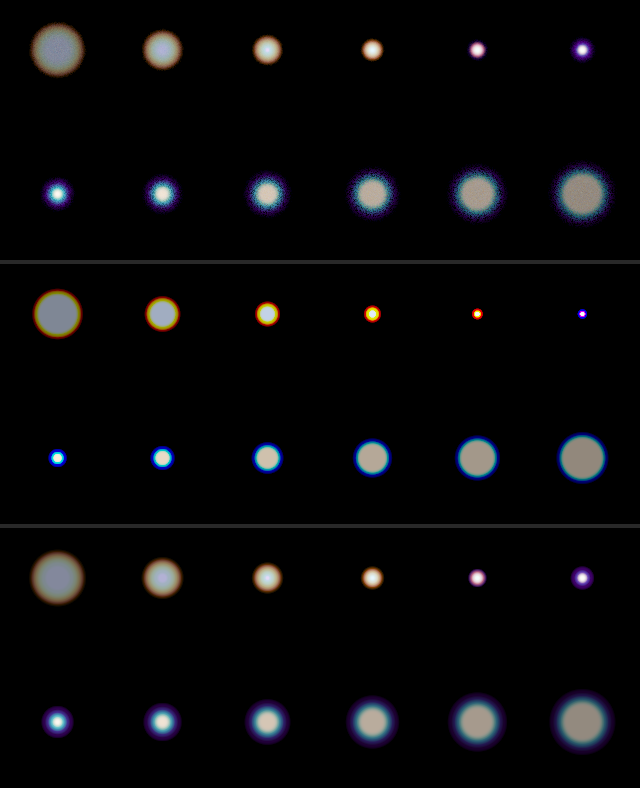
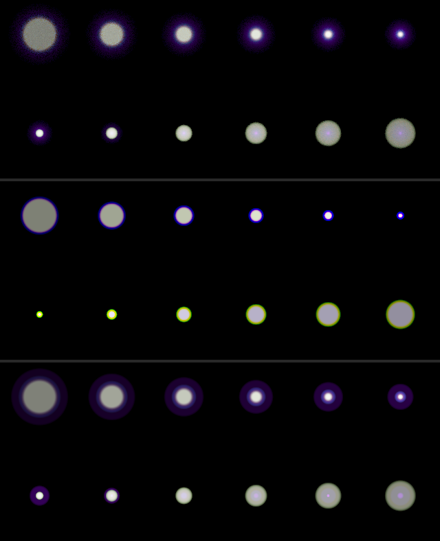
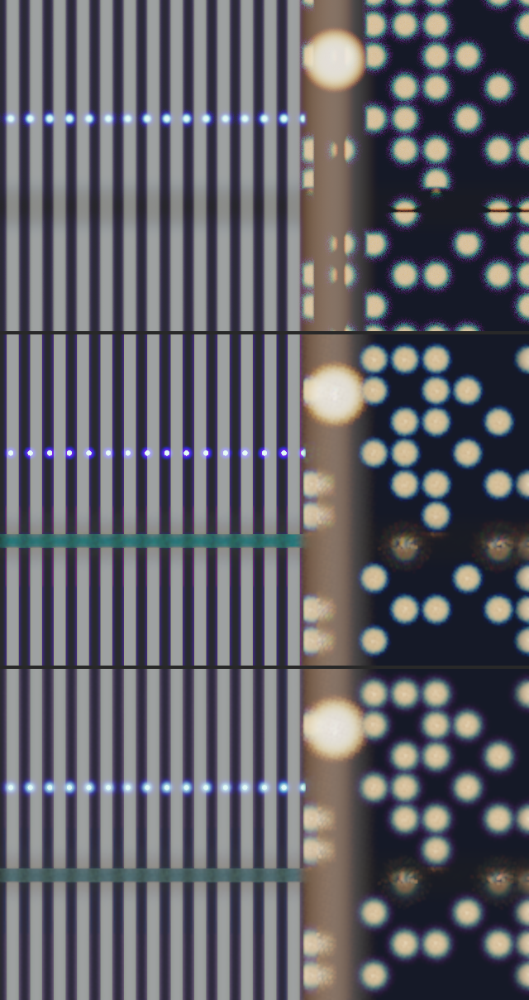
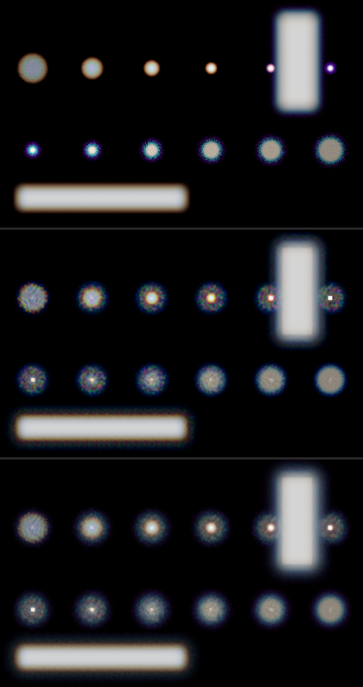
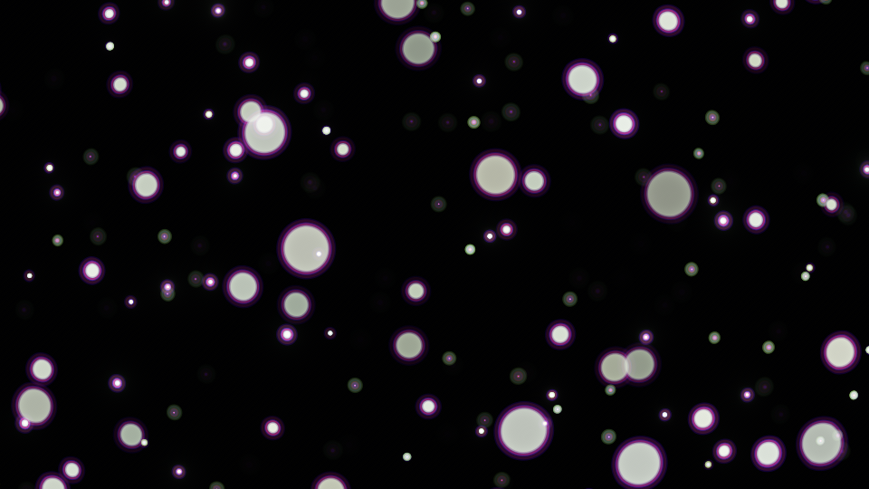
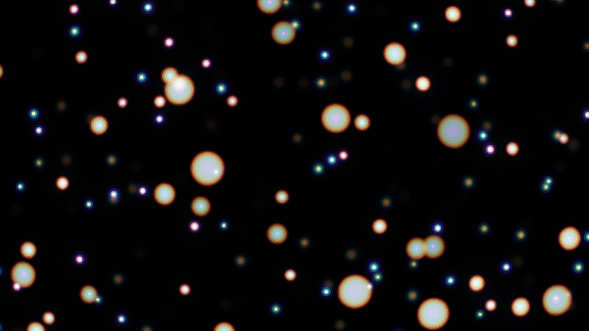
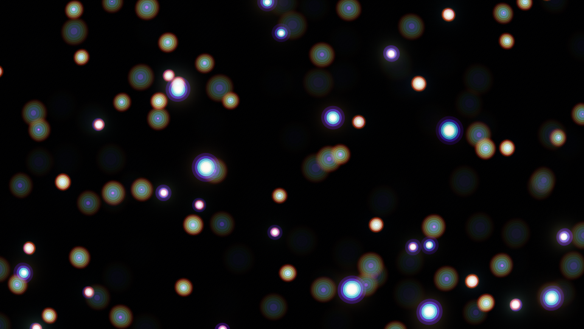

# Spectral depth of field (story 9.7)

Longitudinal chromatic aberration: each wavelength focuses at a slightly different distance, so out of focus a bright point fringes one colour outside and its complement inside. The question was whether drawing it with a circle of confusion per channel (three) is enough, or whether it takes one per wavelength (eight), for the shared point layer and for gather (3.9's chosen method), measured against story 3.1's reference traced spectrally.

Numbers: `docs/studies/spectral-dof.json`, written by `experiments/spectral-dof.test.ts` (`npx vitest run --config experiments/vite.config.ts experiments/spectral-dof.test.ts`). Pictures: `docs/studies/spectral-dof/`. The checks that hold it up: `tests/spectral-dof.test.ts`.

## Verdict

- **Eight wavelengths, not three channels.** On the point layer, eight wavelengths land within the reference's own noise on every lens tried (RMSE 3.4 against a seed-to-seed 4.3 for the singlet). Three channels get the order of the colours right but draw each rim as one hard, saturated ring: they score no better than ignoring the aberration altogether (11.4 against 13.0) and worse in colour (fringe error 7.2 against 5.6). Sixteen wavelengths gain little over eight.
- **On the point layer eight wavelengths are nearly free**: eight discs a point instead of one, and in `spectral-bokeh` at 1080p the frame stays at 0.6 to 0.75 ms whichever is chosen.
- **On gather, eight wavelengths are right but dear**: run once per band, 1.2 ms becomes 3.4 ms for three channels and 9.5 ms for eight at 1080p. They beat three channels on the night and edges shots (RMSE 12.0 against 13.8, 16.6 against 19.4; fringe error 4.9 against 6.7, 5.9 against 9.6). On isolated bright points gather's own artefacts dominate, and eight runs of them score worse than one.
- **For a scene of bright points, draw the points with the point layer** (story 3.5's sprite bokeh does this for highlights it finds in the image; it would take the bands the same way) and keep gather for the extended image. That is also where the fringes are most visible.
- **The sign.** An under-corrected singlet puts the red-orange rim _in front of_ focus and a blue-cyan one behind; the brief's "red outside behind focus" is the over-corrected lens. An achromat's secondary spectrum gives green behind and magenta in front, the "bokeh fringing" of fast lenses. The Epic 9 reference's red rim behind focus therefore needs an over-corrected lens, or (more likely) is halation (10.2) rather than the lens.

## The model

`src/gpu/optics/lca.ts`. The thin lens of story 2.1, with its power depending on the wavelength and the sensor fixed: a wavelength whose power differs from 555 nm's by a share δ is in focus at 1/S' = 1/S + δ/f, and its disc's signed radius is the 555 nm one plus

    shift = δ × blurAtInfinity × S / f

pixels: the aperture's radius on the sensor times δ, the same at every depth. At 85 mm, f/1.4, focused at 2 m on an image 400 pixels tall that radius is 529 px. A wavelength with more power draws a bigger disc behind focus (it rings the others) and a smaller one in front (it sits inside). Any `ThinLens` method can draw one wavelength: the shift is a lens of its own (`shiftedLens`).

Lenses, from Schott's Sellmeier fits (src/gpu/optics/spectral.ts), each channel's mean shift at the study's lens:

| Lens                                                       | δ at 450 / 555 / 650 nm | red, green, blue mean shift (px) |
| ---------------------------------------------------------- | ----------------------- | -------------------------------- |
| singlet, N-BK7                                             | +0.0136 / 0 / −0.0072   | −1.66, +0.41, +3.43              |
| achromat, N-BK7 + F2, F and C together                     | −0.0016 / 0 / −0.0005   | −0.19, −0.11, −0.43              |
| achromat × 10                                              |                         | −1.90, −1.05, −4.35              |
| secondary × 10 (the achromat's parabola, without the curl) |                         | −1.93, −0.90, −2.30              |

The achromat's blue end curls up steeply (−0.0051 at 400 nm, ten times the blue channel's mean): scaled up, it is a violet halo round everything near focus first and a green rim second. The `secondary` lens is the parabola through the achromat's F and C focus without the curl, a stylised fast lens, and the gallery effect's default.

Three channels (`channels`): each channel's light drawn at its response-weighted mean shift. Eight wavelengths: `spectralSamples(8)`, 400 to 700 nm, each with its white-balanced share of red, green and blue. In both the shares sum to white, so each channel keeps its light.

## The reference

`src/gpu/dof/spectral-reference.ts` and `.wgsl`, which include `scene.wgsl` whole (its shots are reused, not copied; nothing shared was edited). Story 3.1's distributed ray tracing through the thin lens, each ray carrying four hero wavelengths (story 9.1) a quarter of the range apart, each traced towards its own plane of focus from the same point on the lens. Each channel's light is spread over the wavelengths it responds to, so a white surface is an equal-energy spectrum. Two shots were added for fringes: `fringe-points`, twelve white points of radius 1.5 px from 1 m to 40 m with the lens focused at 2 m, and `fringe-bars`, a white bar at 6 m and one at 1.3 m (`fringe` has both). The point layer draws each scene point as seven discs filling its 1.5 px, so the comparison sees the aberration and not the point's size.

All at 640 × 400, 85 mm, f/1.4. The reference's noise is measured by tracing it again with another seed.

## Point layer

`fringe-points`, focus 2 m, 4 096 rays a pixel (16 384 wavelengths). RMSE in 8-bit levels as displayed, SSIM on displayed luminance, and **fringe**: the RMSE of the displayed colour with each pixel's grey taken out, the error in the colours alone.

| Lens                   | reference, another seed | none               | 3 channels         | 8 wavelengths         | 16 wavelengths    |
| ---------------------- | ----------------------- | ------------------ | ------------------ | --------------------- | ----------------- |
| singlet                | 4.34, 0.989, 2.44       | 13.01, 0.948, 5.61 | 11.42, 0.953, 7.22 | **3.36, 0.992, 1.92** | 3.18, 0.993, 1.78 |
| over-corrected singlet | 3.62, 0.991, 2.05       | 12.65, 0.950, 5.45 | 11.39, 0.955, 7.32 | **2.86, 0.994, 1.67** | 2.67, 0.995, 1.50 |
| achromat               | 1.58, 0.994, 0.68       | 2.75, 0.995, 1.27  | 2.29, 0.996, 1.22  | **1.27, 0.997, 0.55** | 1.23, 0.997, 0.50 |
| achromat × 10          | 3.38, 0.988, 2.14       | 11.65, 0.940, 4.94 | 11.10, 0.943, 7.26 | **3.49, 0.987, 2.25** | 2.69, 0.990, 1.70 |
| secondary × 10         | 2.62, 0.994, 1.64       | 9.66, 0.974, 2.58  | 8.01, 0.977, 3.62  | **2.15, 0.995, 1.27** | 1.93, 0.996, 1.19 |

(RMSE, SSIM, fringe.) The real achromat at f/1.4 is below a pixel in every channel: there is almost nothing to draw, and ignoring it costs 2.8 levels.

_Singlet. Top: the reference; middle: three channels; bottom: eight wavelengths. Each band shows, left to right, points at 1, 1.2, 1.4, 1.6, 1.8 and 2 m (top row) and 2.5, 3, 4, 6, 10 and 40 m (bottom row). Note the violet halo on the in-focus point at 2 m, which three channels draw as a hard blue ring._

_Achromat × 10, the same layout: the violet curl makes a purple halo near focus; behind focus a green rim. Three channels draw it as a yellow-green ring the reference does not have._

### Fringe colours

Rim (0.8 to 1 R plus 2 px) and middle (within 0.55 R) of the point at 1.2 m (in front of focus) and at 6 m (behind). B/R and G over the mean of R and B, rim against middle:

| Lens, point           | reference                                 | 3 channels                              | 8 wavelengths                           |
| --------------------- | ----------------------------------------- | --------------------------------------- | --------------------------------------- |
| singlet, 1.2 m        | orange rim (B/R 0.36), blue middle (2.09) | yellow rim (0.06), blue middle (2.08)   | yellow rim (0.35), blue middle (2.11)   |
| singlet, 6 m          | cyan rim (2.12), orange middle (0.55)     | cyan rim (2.24), orange middle (0.52)   | cyan rim (2.15), orange middle (0.54)   |
| over-corrected, 1.2 m | cyan rim (2.17), orange middle (0.54)     | cyan rim (2.28), orange middle (0.52)   | cyan rim (2.17), orange middle (0.54)   |
| over-corrected, 6 m   | orange rim (0.36), blue middle (2.11)     | yellow rim (0.06), blue middle (2.08)   | yellow rim (0.35), blue middle (2.11)   |
| achromat × 10, 6 m    | green rim (G 1.40), blue middle (G 0.76)  | green rim (G 3.17), blue middle (0.70)  | green rim (G 1.45), blue middle (0.73)  |
| secondary × 10, 6 m   | green rim (G 1.46), white middle (0.79)   | green rim (G 1.98), white middle (0.84) | green rim (G 1.52), white middle (0.77) |

Both approximations have the order right on every lens and side, and `tests/spectral-dof.test.ts` checks it. Eight wavelengths match the reference's ratios to a few per cent; three channels over-saturate the rim: the singlet's front rim has a sixth of the blue it should (B/R 0.06 against 0.36), the achromat's back rim twice the green. (The colour names are a coarse hue reading of each measured colour; "yellow" and "orange" are the same rim at slightly different hues.) In front of focus the achromat × 10 and secondary × 10 points measure as white: their magenta rim is a thin, dim halo outside the measured annulus.

## Gather

Run once per band with each band's lens (`src/gpu/dof/spectral-dof.ts`, any `DofMethod`; each band its own instance, since a method writes its uniforms at encode time), the images summed by each band's shares. 2 048 rays a pixel. RMSE, SSIM, fringe:

| Lens, shot (focus)           | reference, another seed | reference without aberration | gather, none           | gather, 3 channels     | gather, 8 wavelengths      |
| ---------------------------- | ----------------------- | ---------------------------- | ---------------------- | ---------------------- | -------------------------- |
| singlet, night (2.5 m)       | 5.59, 0.968, 3.74       | 15.34, 0.916, 6.76           | 17.82, 0.876, 7.66     | 13.81, 0.889, 6.69     | **11.98, 0.911, 4.95**     |
| singlet, edges (3 m)         | 7.39, 0.969, 4.67       | 22.75, 0.812, 9.34           | 25.03, 0.798, 10.30    | 19.43, 0.844, 9.56     | **16.59, 0.902, 5.92**     |
| singlet, bars (2 m)          | 1.28, 0.998, 0.87       | 6.68, 0.970, 4.00            | 6.57, **0.944**, 4.01  | **6.00**, 0.942, 2.79  | 6.61, 0.921, **2.13**      |
| singlet, points + bars       | 7.11, 0.975, 3.94       | 14.62, 0.919, 6.96           | **16.54, 0.846**, 6.98 | 17.06, 0.839, 7.61     | 18.27, 0.775, **6.15**     |
| achromat × 10, night         | 2.36, 0.991, 1.41       | 11.77, 0.960, 4.53           | 16.76, 0.881, 5.56     | 13.08, **0.911**, 6.39 | **12.17**, 0.910, **3.86** |
| achromat × 10, edges         | 2.57, 0.996, 1.51       | 17.15, 0.922, 7.87           | 23.91, 0.828, 8.50     | 19.27, 0.892, 8.86     | **16.35, 0.897, 4.29**     |
| achromat × 10, bars          | 1.33, 0.997, 0.85       | 8.45, 0.958, 3.84            | 7.74, 0.949, 3.84      | 6.38, **0.956**, 3.57  | **5.74**, 0.954, **1.46**  |
| achromat × 10, points + bars | 5.40, 0.976, 3.41       | 14.31, 0.904, 6.29           | 17.76, 0.840, 6.31     | **15.36, 0.865**, 7.26 | 15.44, 0.857, **4.45**     |

On the night and edges shots the aberration is a large part of the error (the reference without it is 12 to 23 levels off), and eight wavelengths recover much of it; three channels about half as much, and with worse colour than no aberration at all on the achromat. On isolated bright points gather is the problem: half resolution and its tiled near field give every point a grainy halo, and eight runs give eight halos at eight sizes, which costs SSIM. On the bars eight wavelengths have the best colour but the lowest SSIM, from the same per-band near field. In the edges shot gather's near field also tints the blurred rail teal when run per band (its coverage of a thin foreground changes with the band's radius, and the bands disagree); the reference shows it grey.

_Edges shot, singlet, focus 3 m. Top: the reference; middle: gather with three channels; bottom: eight wavelengths. The lamps' rims and the post's fringes; the teal rail is gather's near field._

_Points and bars, singlet, the same order: gather's halos round every point._

## Cost

Apple M1 Max, Dawn, GPU timestamps (`tests/bench.ts`'s slope), 1920 × 1080:

| What                                      | none    | 3 channels | 8 wavelengths |
| ----------------------------------------- | ------- | ---------- | ------------- |
| `spectral-bokeh` at its defaults, a frame | 0.68 ms | 0.59 ms    | 0.74 ms       |
| gather, night shot (85 mm f/1.8, 2.5 m)   | 1.20 ms | 3.39 ms    | 9.48 ms       |

The effect's three are within the run's noise: its HDR tail is most of the frame and the extra discs are cheap. Gather scales with the bands, as it must when run once per band; a gather written to carry three circles in one pass (one ring kernel, three weights a tap) would cost little more than one, and is the obvious next step if gather is to have the aberration in production. Eight wavelengths in one pass would need eight weights a tap and is not worth it next to drawing the bright points as points.

## The gallery effect

`spectral-bokeh`: lights at many depths on the point layer, each split into eight wavelengths, the focus slowly racking so the rims swap sides. Its notes are in `src/effects/spectral-bokeh/notes.md`.

_Fast lens (the secondary spectrum × 10): magenta rims on the big discs in front of focus, green on the small ones behind._

_Singlet: orange rims in front of focus, cyan behind._

_Over-corrected singlet focused at 1.6 m, most lights behind focus: the red-orange rim behind focus._

## Caveats

- One machine, one GPU, Dawn. Not run in a browser or on a phone.
- Half-float blending in the point layer loses about 0.02 % of the light a disc laid over the same pixels: about 0.8 % for eight wavelengths, 1.5 % for sixteen (not the layer's maths: it does not depend on the brightness).
- The reference is a thin lens: no spherochromatism, no lateral colour, no aperture-dependent focus shift. Real fast lenses fringe mostly through spherochromatism, which is why the gallery effect's "fast lens" is ten times the paraxial secondary spectrum.
- The fringe-colour readings are means over fixed annuli; a rim thinner than the annulus reads paler than it looks.
